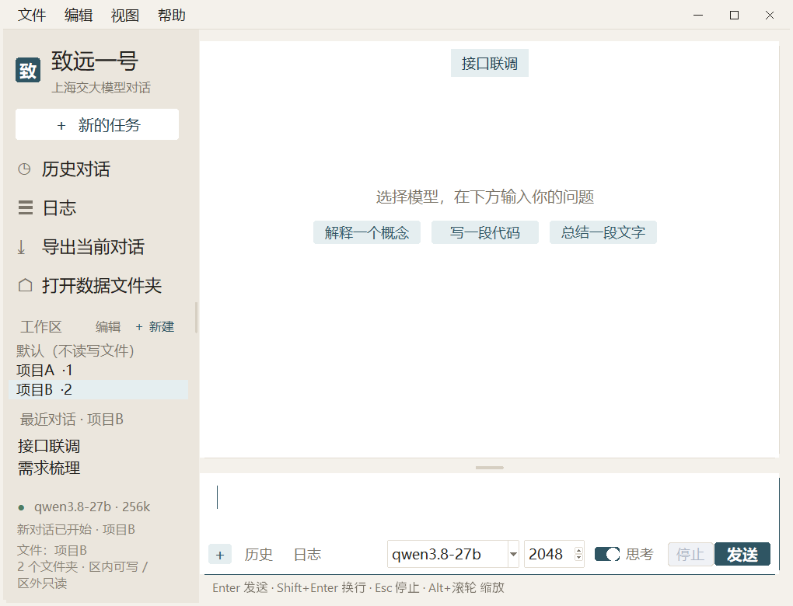

# 交大“致远一号”对话窗口

上海交大“致远一号”大模型的 Windows 桌面客户端。纯 Python 标准库（tkinter），无第三方依赖，整个文件夹拷走即可运行。



## 功能

- **流式对话**：5 个模型可切换（qwen3.8-27b、deepseek-chat、deepseek-reasoner、qwen、claw），可开关“思考”过程，Esc 随时停止。
- **多工作区**：每个工作区可绑定多个文件夹，每个工作区下可开多个对话；会话按工作区归档。
- **AI 文件工具**：列目录、读文件、搜索、写入、编辑、删除、移动/重命名、执行脚本；区内可写，区外只读；每次操作弹窗确认，写入/删除前自动备份，审计日志不含正文。
- **界面**：参考 Qoder 的自绘界面；侧栏、对话区、输入区可拖拽调尺寸并记忆；窗口尺寸持久化；Alt+滚轮缩放字号；细滚动条。
- **内容**：简易 Markdown 渲染、代码块、宽表格横向滚动与查看/复制（TSV）；历史对话、按天日志、导出。
- **协议层**：`sjtu_api.py` 同时提供命令行 `models` / `chat` / `agent`，支持 OpenAI 与 Anthropic 两种协议。

## 环境要求

- Windows 10 / 11
- Python 3.10 或更高版本（安装时勾选 **Add Python to PATH**；tkinter 随官方安装包自带）
- 交大“致远一号” API 密钥；校外访问需要校园 VPN

## 快速开始

1. 克隆仓库：

   ```bash
   git clone https://github.com/JiachengOuyang/sjtu-zhiyuan-chat.git
   ```

2. 在 `程序/` 下把 `.env.example` 复制为 `.env`，填写密钥：

   ```ini
   SJTU_API_KEY=你的交大 API 密钥
   SJTU_BASE_URL=https://models.sjtu.edu.cn/api/v1
   ```

3. 双击 `启动对话窗口.bat`。首次运行会按本机 Python 路径生成 `交大致远一号.lnk`，之后可直接用快捷方式启动。

也可以直接运行 `python 程序/sjtu_chat.pyw`（会保留控制台，便于看报错）。

## 目录结构

```text
.
├─ 启动对话窗口.bat      双击启动，自动重建快捷方式
├─ make_shortcut.ps1     按本机 pythonw 路径生成 .lnk
├─ 使用说明.md           完整使用手册（工作区、权限、迁移）
├─ docs/screenshot.png   界面截图
├─ 程序/
│  ├─ sjtu_chat.pyw      窗口程序（tkinter，单文件）
│  ├─ sjtu_api.py        交大 API 协议层（OpenAI / Anthropic）
│  ├─ file_tools.py      文件工具与安全规则
│  ├─ icon.ico           应用图标
│  └─ .env.example       配置模板
└─ 数据/                 首次运行自动创建，不入库
```

## 文件工具的安全规则

- 工作区绑定的文件夹及其子文件夹可读写；区外只读，写入/删除/移动/执行直接拒绝。
- 读取、写入、删除、移动、执行都逐次弹窗确认；默认拒绝，Esc 或关窗也等于拒绝，180 秒超时。
- 覆盖/修改/删除前自动备份，每个工作区保留最近 30 份。
- 删除只支持单个文本文件或空文件夹，不递归；移动不覆盖、不跨盘。
- 只执行工作区内已有的 `.py/.bat/.cmd/.ps1`，不接受参数，120 秒超时，输出上限 64KB。
- 脚本不是沙箱，以当前 Windows 用户权限运行；请只运行信任的脚本。
- 详细规则见 [使用说明.md](使用说明.md)。

## 隐私

仓库**不包含**以下内容，均已加入 `.gitignore`：

- `程序/.env`（API 密钥）
- `数据/`（对话记录、日志、工作区路径、文件备份、窗口设置）
- `*.lnk`（按本机路径生成）
- `临时文件/`、`__pycache__/`、`*.log`

对话内容会发送到交大模型接口。请勿把含密钥、隐私或他人数据的文件夹设为工作区。

## 说明

- 界面视觉参考 Qoder。
- 后端接口：`https://models.sjtu.edu.cn/api/v1`，限额约 10 次/分钟、10 万 token/分钟。

## 许可证

[MIT](LICENSE) © 2026 JiachengOuyang
